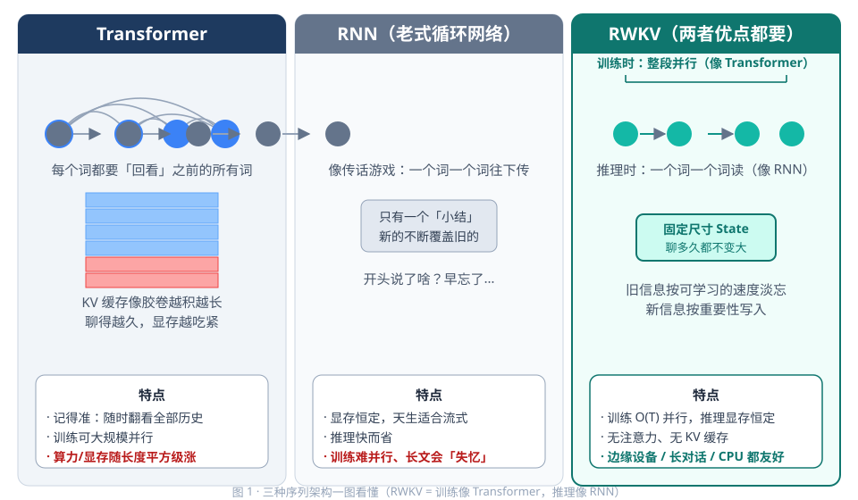
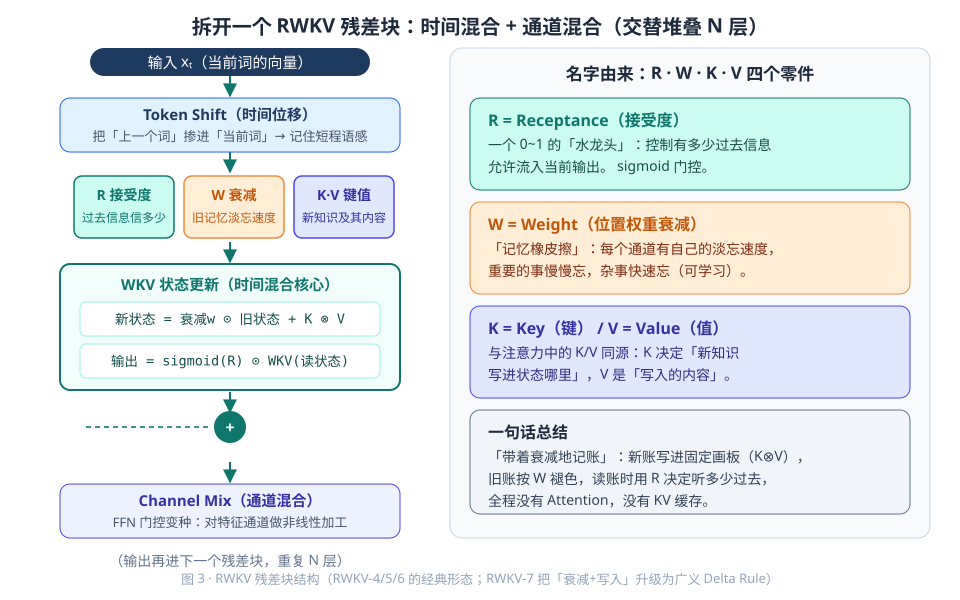
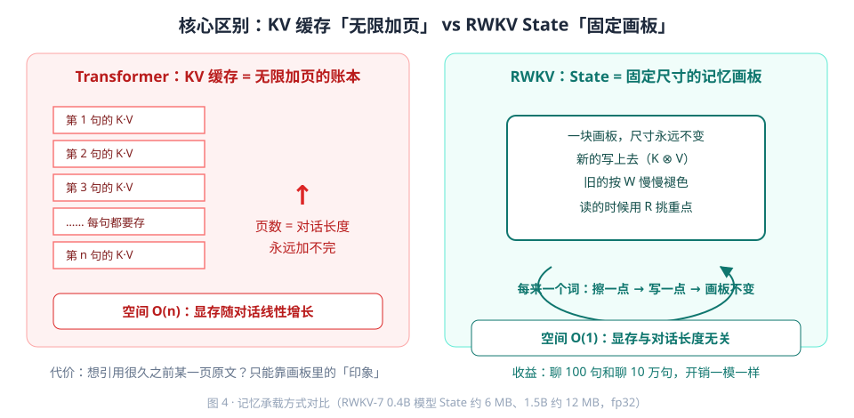
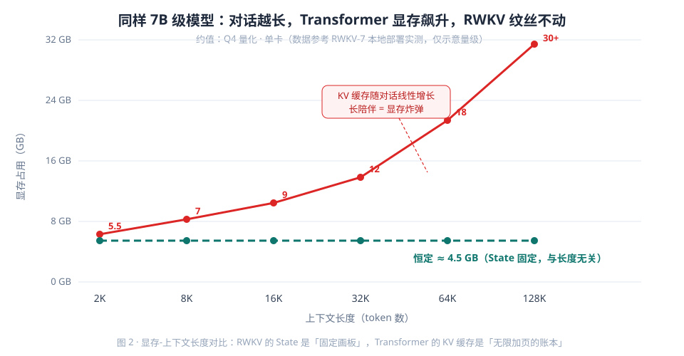
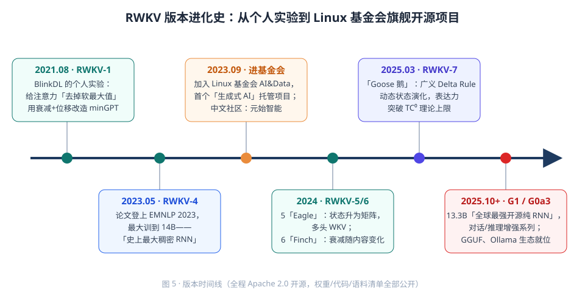
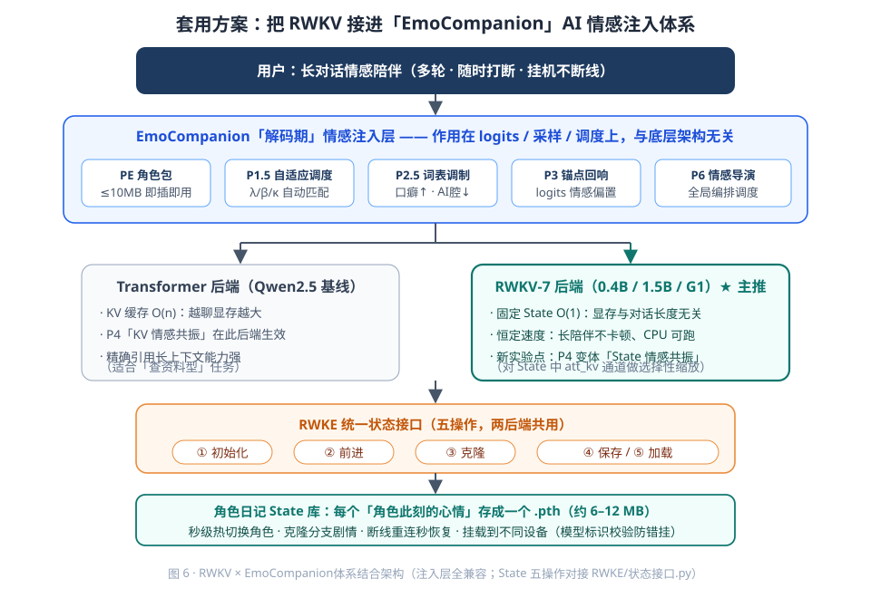
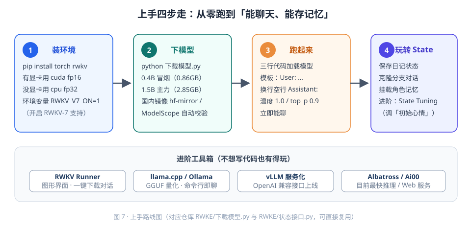

# RWKV 小白超入门：一口气看懂这个「不像 Transformer 的 Transformer」

> 本文档面向零基础读者。全程使用生活化类比，配 7 张示意图，看完你能回答四个问题：
> **RWKV 是什么？它特殊在哪？它和 Transformer 有什么区别？怎么把它用到我们「EmoCompanion AI 情感注入」项目里？**

---

## 目录

1. [一句话看懂 RWKV](#一一句话看懂-rwkv)
2. [先补课：Transformer 和 RNN 是什么](#二先补课transformer-和-rnn-是什么)
3. [RWKV 的特殊之处：四个零件 + 一块固定画板](#三rwkv-的特殊之处四个零件--一块固定画板)
4. [RWKV 版本进化史](#四rwkv-版本进化史)
5. [与 Transformer 架构的全面区别](#五与-transformer-架构的全面区别)
6. [怎么用：从安装到对话](#六怎么用从安装到对话)
7. [套用到我们EmoCompanion项目的方案](#七套用到我们EmoCompanion项目的方案)
8. [上手路线图与工具箱](#八上手路线图与工具箱)
9. [常见疑问 FAQ](#九常见疑问-faq)
10. [信息来源](#十信息来源)

---

## 一、一句话看懂 RWKV

**RWKV = 一个「训练时像 Transformer 一样高效、推理时像 RNN 一样省内存」的大语言模型架构。**

名字拆开看（不用记住，知道是四个零件的缩写即可）：

| 字母 | 全称 | 白话解释 |
|:---:|:---|:---|
| **R** | Receptance（接受度） | 「门卫」：决定上一个字的信息要放多少进来 |
| **W** | Weight（位置权重） | 「遗忘曲线」：越久远的信息衰减得越多 |
| **K** | Key（键） | 「标签」：当前这个字的重要特征 |
| **V** | Value（值） | 「内容」：当前这个字实际携带的信息 |

如果你只想记住一个类比，记住这个：

> **Transformer 读长文章要「翻回前文反复对照」（每一页都要把前面所有页摊在桌上），越读桌上越挤；**
> **RWKV 读长文章只靠「一块固定大小的记忆画板」——每读一个字，就用新信息更新画板，旧信息按规律淡出。桌上永远只有一块画板，多长的文章都不怕。**

这块「记忆画板」就是 RWKV 的核心武器——**固定大小的 State（状态）**。



---

## 二、先补课：Transformer 和 RNN 是什么

### 2.1 Transformer：当红炸子鸡（ChatGPT 的底层）

Transformer 是 2017 年 Google 提出的架构，如今几乎所有大模型（GPT、Qwen、DeepSeek、LLaMA……）都基于它。它的核心是**注意力机制（Attention）**：

- 处理第 1000 个字时，它会「回头看」前面全部 999 个字，计算相关性，挑重点吸收。
- **优点**：看得全、效果猛、训练时可以几百个字同时并行算，吃满了 GPU 的并行能力。
- **缺点**：看回头的代价随字数**平方级**增长——文章长 10 倍，计算量涨 100 倍。推理时还必须把「看过的所有字的重点笔记」（KV 缓存）一直存着，上下文越长，显存吃得越多。

### 2.2 RNN：老前辈（2017 年之前的主流）

RNN（循环神经网络）是更老的一代架构：

- 像人逐字读书：读第 1000 个字时，只依赖第 999 个字留下的「读后感」。
- **优点**：无论读多长，占用的内存**恒定不变**（只保留一份「读后感」）。
- **缺点**：逐字串行处理，训练慢得无法忍受；「读后感」容量有限，读到后面忘了前面，长文效果差。

### 2.3 一张表看懂两代架构的取舍

| 维度 | Transformer | RNN |
|:---|:---:|:---:|
| 训练速度 | 快（全并行） | 慢（逐字串行） |
| 推理显存 | 随上下文线性增长 | 恒定 |
| 长文本效果 | 好 | 差（健忘） |
| 工程生态 | 极其丰富 | 几乎没有 |

于是问题来了：**能不能同时拿到 Transformer 的「训练快」和 RNN 的「推理省」？**

RWKV 的回答：**能。**

---

## 三、RWKV 的特殊之处：四个零件 + 一块固定画板

### 3.1 双模特性：训练像 Transformer，推理像 RNN

RWKV 最特别的设计是它在两个阶段「换了一张脸」：

- **训练阶段**：它长得像 Transformer——整段文字可以并行计算，GPU 吃满，训练效率和大模型主流架构同级。
- **推理阶段**：它切换成 RNN 模式——逐字生成，每一步只更新一块**固定大小的 State**，计算量和内存都不随对话长度变化。

这就是「两栖动物」：水里（训练）用一套高效呼吸方式，陆地（推理）换另一套，两边都占便宜。

### 3.2 一个 RWKV 块内部长什么样

每个 RWKV 块（Block）由两部分组成，流程如下：



1. **Token Shift（字间错位）**：把上一个字的部分信息「挪」进当前字的向量里，相当于给每个字发一份「前任的备忘」。这是 RWKV 处理字与字关系的地基。
2. **四通道投影（R/W/K/V）**：当前字被投影出四个角色——
   - **R（接受度门卫）**：0～1 之间的小数，控制「上一个时刻的信息放多少进来」；
   - **W（遗忘曲线）**：一个衰减系数，越久远的记忆衰减越狠（像艾宾浩斯遗忘曲线，但是每个通道各有自己的曲线，后来版本还升级成「按内容决定遗忘速度」）；
   - **K（标签）**：这个字的特征标签；
   - **V（内容）**：这个字真正要传递的信息。
3. **WKV 状态更新（核心引擎）**：拿 K 和 V 去更新那块「固定画板」（State），更新力度由 W（衰减）和 R（门控）共同调节。公式上这是一个线性（一次方程式）的加权累积，所以叫「线性注意力」。
4. **Channel Mix（通道搅拌）**：另一条支路，对信息做非线性混合提炼，补充表达力。

**关键点：整个块里没有任何「回头扫全部历史」的操作。** 所有历史信息都被压缩进固定大小的 State 里。这是它与 Transformer 注意力的根本分野。

### 3.3 固定画板 vs 无限加页的账本

用记笔记的方式对比两种记忆管理：



- **Transformer 的 KV 缓存 = 无限加页的账本**：每读一个字就添一页（存一组 K/V 向量）。对话 2000 字时账本还不算厚；对话 12.8 万字时，7B 模型的账本能吃掉 25GB 以上显存——很多显卡直接罢工。
- **RWKV 的 State = 固定画板**：不管读多少字，画板就这么大，每读一个字做一次「擦一点旧的、画一点新的」。0.4B 模型的 State 约 **6MB**，1.5B 约 **12MB**——相当于一张手机照片的大小。

这带来一个惊人的工程结论：**RWKV 推理时的显存占用，从第 1 个字到第 100 万个字，几乎是一条水平线。**



> 图中数据为 7B 级别模型 Q4 量化的典型实测/官方参考值：Transformer 在 2K 上下文约 5.5GB，128K 上下文超过 30GB；RWKV 全程约 4.5GB。**这条水平线就是 RWKV 最大的卖点。**

### 3.4 State 里到底装了什么

以 RWKV-7 为例，每层的 State 包含三件套（都以高精度 fp32 保存，防止长对话累积误差）：

| 组件 | 白话解释 |
|:---|:---|
| `att_x_prev` | 注意力层上一个字的「残留向量」（Token Shift 的备份） |
| `att_kv` | 注意力层的「画板本体」（K/V 累积状态矩阵） |
| `ffn_x_prev` | 通道搅拌层的上一个字残留向量 |

- 0.4B 模型：24 层 × 3 张量 ≈ **6MB**；
- 1.5B 模型：24 层 × 3 张量 ≈ **12MB**。

**一块 State 就是一个对话的全部记忆。** 保存它 = 存档对话；加载它 = 恢复对话；克隆它 = 复制出一个平行世界的对话。这个特性后面在我们的EmoCompanion方案里会大放异彩。

---

## 四、RWKV 版本进化史

RWKV 不是横空出世的作品，而是开源社区持续打磨多年的成果：



| 版本 | 时间 | 关键升级 | 白话理解 |
|:---:|:---:|:---|:---|
| RWKV-1 | 2021.08 | 提出 AFT 简化注意力雏形 | 「图纸阶段」 |
| RWKV-4 | 2023 | 论文发表于 EMNLP，做到 14B——**当时全球最大的稠密 RNN**；进入 Linux 基金会旗下开源项目 | 「成年礼」 |
| RWKV-5 Eagle | 2023 末 | 状态从向量升级为**矩阵**，多头机制 | 画板从「一条线」变成「一整面墙」 |
| RWKV-6 Finch | 2024 | 衰减系数 W 变成**数据相关**——模型自己决定该忘多少 | 画板学会了「智能橡皮擦」 |
| **RWKV-7 Goose** | 2025.03 | **广义 Delta Rule**：状态动态演化，可以「定向覆盖」旧记忆；表达力突破 TC⁰ 复杂度类上限，理论计算能力超过同规模 Transformer | 画板升级为「会自我重组的白板」，旧记忆可被精准改写而非只被淡忘 |
| G1 / G0a3 | 2025.10+ | 官方开源 13.3B 大版本，多语言混合训练（含中文优化） | 「全面工业化」 |

**小白只需记住**：RWKV-7 是当前推荐版本——它不只是「省内存的替代品」，官方声称在同等参数量下理解能力已能对标主流 Transformer 模型（其 World 系列双语料对中文相当友好）。

---

## 五、与 Transformer 架构的全面区别

### 5.1 核心机制对比

| 对比维度 | Transformer | RWKV（以 v7 为例） |
|:---|:---|:---|
| **核心算子** | 自注意力：每个字对全部历史字做加权求和，复杂度 **O(T²)** | WKV 线性状态更新：每字只与固定 State 交互，复杂度 **O(T)** |
| **记忆载体** | KV 缓存：随上下文**无限增长** | 固定 State：大小**恒定**（0.4B 约 6MB） |
| **训练并行性** | 全并行 | 同样全并行（训练时等价注意力形式） |
| **推理模式** | 逐 token，且每步要读写不断变长的缓存 | 逐 token，每步只做一次固定大小的状态更新 |
| **长上下文成本** | 显存线性涨、速度线性慢 | 显存不变、每步耗时恒定 |
| **「遗忘」能力** | 天生过目不忘（全历史可查） | 主动遗忘 + 定向覆盖（v7 Delta Rule），更像人类记忆 |
| **理论表达力** | TC⁰ 内 | v7 广义 Delta Rule **突破 TC⁰**（官方论文声称可表达正则语言计数等 Transformer 做不到的任务） |
| **生态成熟度** | 极其成熟（几乎所有训练/推理框架原生支持） | 快速成长中（Runner、llama.cpp、vLLM、Ollama 等均已支持） |
| **部署门槛** | 长上下文需要大显存或复杂分页缓存 | 普通显卡/甚至 CPU 即可跑长对话 |

### 5.2 一句话总结区别

> **Transformer 用「无限增长的笔记」换取完美记忆；RWKV 用「固定画板上的智能摘要」换取恒定成本。前者是过目不忘的学霸但书桌会爆，后者是记性极好的实干家且书桌永远整洁。**

### 5.3 什么时候选 RWKV

- 长对话陪伴型应用（情感陪伴、角色扮演、客服）——State 恒定，成本可控；
- 边缘设备 / 消费级显卡部署——显存需求低且不随对话增长；
- 需要大量并发会话的服务端——每个会话只占几 MB 状态，单卡能挂成千上万个会话；
- 需要「对话存档 / 恢复 / 分叉」的功能——State 可序列化，天生适合。

---

## 六、怎么用：从安装到对话

### 6.1 三行代码跑起来（最简路径）

```bash
pip install rwkv
```

```python
import os
os.environ["RWKV_V7_ON"] = "1"          # 启用 RWKV-7 内核

from rwkv.model import RWKV             # pip 装的 rwkv 包
from rwkv.utils import PIPELINE

model = RWKV(model="RWKV-x070-World-0.4B-v2.9-20250107-ctx4096.pth", strategy="cuda fp16")
pipeline = PIPELINE(model, "rwkv_vocab_v20230424")   # World 系列通用词表

prompt = "User: 你好呀，今天心情不太好。\n\nAssistant:"
output = pipeline.generate(prompt, token_count=200, temperature=1.0, top_p=0.9)
print(output)
```

三个要素：
1. **模型文件（.pth）**：从 HuggingFace（或国内镜像 hf-mirror.com）下载；
2. **strategy**：告诉它算力放哪——`cuda fp16`（显卡半精度）或 `cpu fp32`（纯 CPU，慢但能跑）；
3. **聊天模板**：RWKV-World 系列习惯用 `"User: {问题}\n\nAssistant:"` 格式，生成到 `"\n\nUser:"` 停止。

### 6.2 更省心的路径：图形界面工具

不想写代码？两个推荐工具：

- **RWKV Runner**（官方桌面客户端，Windows 直接双击安装）：图形界面下载模型、调参数、开对话，还内置 API 服务模式；
- **Ai00 Server**（社区明星项目）：WebUI + REST API，支持并发与 State 管理。

### 6.3 我们项目内的标准路径：RWKE 模块

我们的 `<workspace>/RWKE\` 目录已经封装好全流程：

| 文件 | 作用 |
|:---|:---|
| [下载模型.py](file:///<workspace>/RWKE/下载模型.py) | 一键下载模型矩阵：RWKV7-World-0.4B（0.86GB）/ RWKV7-World-1.5B（2.85GB）/ Qwen2.5-1.5B-Instruct（2.88GB 对照基线），双源（hf-mirror / ModelScope）自动切换，SHA256 校验，断点续传 |
| [状态接口.py](file:///<workspace>/RWKE/状态接口.py) | 统一状态抽象层（下节详解） |
| [系统配置.json](file:///<workspace>/RWKE/系统配置.json) | 模型参数、采样协议（温度 1.0 / top_p 0.9 / top_k 50 / 种子 42）、聊天模板等全套配置 |

使用顺序：`python 下载模型.py` 下载 → 通过状态接口加载模型 → 按统一模板对话。

---

## 七、套用到我们EmoCompanion项目的方案

### 7.1 EmoCompanion技术体系回顾

我们的「EmoCompanion AI 情感注入技术体系」共 8 层：PE（数据层）→ P1.5（调度）→ P2.5（token 概率）→ P3（锚点 logits）→ P4（KV 共振）→ P5（超融合）→ P6（导演）。目前全部实验跑在 **Qwen2.5-1.5B** 基线上，情感注入大量依赖 **P4 层操作 KV 缓存**。

### 7.2 为什么 RWKV 天生适合「AI 情感陪伴」场景

| 场景需求 | Transformer（Qwen）现状 | RWKV 带来的改变 |
|:---|:---|:---|
| 7×24 长情陪伴对话 | KV 缓存随对话增长，长对话后显存爆炸，必须截断历史 | State 恒定 12MB，**理论上可以陪聊一整年不断档** |
| 多角色同时在线 | 每个会话独立 KV 缓存，显存 × 会话数 | 每会话 12MB，单卡挂几百个「角色分身」 |
| 角色记忆存档/恢复 | 序列化 KV 缓存体积大、结构复杂 | State 直接 `torch.save`，一个角色日记 = 一个几 MB 的 .pth |
| 情感状态注入 | P4 操作 KV 缓存（数据相关、位置敏感） | 对 State 做情感偏置（结构固定、语义稳定，**可能是更干净的注入面**） |

### 7.3 RWKE 统一状态接口：双后端自由切换

[状态接口.py](file:///<workspace>/RWKE/状态接口.py) 定义了抽象基类「推理状态」，规定**五个标准操作**：

```python
class 推理状态(ABC):
    初始化(模型)          # 建立空白 State / 空 KV 缓存
    前进(tokens) -> 状态  # 喂入文字，状态向前演化一步
    克隆() -> 状态         # 复制当前状态（平行对话）
    保存(路径)             # 序列化到磁盘（角色存档）
    加载(路径) -> 状态     # 从磁盘恢复
```

并实现了两个适配器：

- **RWKV状态**：包装 RWKV 的固定 State（扁平张量列表，O(1) 内存）；
- **KV缓存状态**：包装 Qwen 的 HF `past_key_values`（O(n) 内存）。

`加载状态()` 函数根据模型文件的元数据**自动分派后端**，上层业务代码（P4 注入、P6 导演）**一行不用改**就能在两个模型世界间切换。

### 7.4 P4 层的 RWKV 变体：「State 情感共振」

现有 P4 层向 KV 缓存注入情感向量。在 RWKV 侧，对应的注入面变为 State 矩阵：

| | P4-KV（现方案） | P4-State（RWKV 新实验点） |
|:---|:---|:---|
| 注入对象 | `past_key_values`（随对话增长） | `att_kv` 状态矩阵（恒定大小） |
| 注入时机 | 每个 token 前向时 | 状态更新时 / 或直接偏置 State 初值 |
| 可解释性 | 位置相关，难以归因 | 结构固定，**可做「情感状态拓扑图」** |
| 与 P6 导演联动 | 控制缓存空间 | 控制一块 12MB 的「情感画板」——**导演可以直接改写角色的情绪底色** |

**值得做的第一批实验**：
1. **情绪底色注入**：在「角色日记 State」加载后，对 `att_kv` 矩阵施加情感方向偏置，观察对话情绪漂移是否可控；
2. **State 克隆分叉**：克隆同一角色的 State，分别注入不同情感做 A/B 对比，量化注入效果；
3. **长期情感记忆测试**：让角色在 1 万轮对话后仍记得「用户喜欢什么」——验证 State 摘要式记忆的实际保真度。

### 7.5 整体架构图



用户的话从顶层流入EmoCompanion注入层（PE 数据 → P1.5 调度 → P2.5 概率 → P3 锚点），随后进入双后端分叉：Qwen 走 P4-KV 共振，RWKV 走 P4-State 情感共振；两个后端都通过 RWKE 五操作（初始化/前进/克隆/保存/加载）对接，最终「角色日记 State 库」让每个角色拥有可持续成长的情感记忆。

---

## 八、上手路线图与工具箱



**四步走**：

1. **装环境**：`pip install rwkv`（或直接用 RWKV Runner 图形界面）；
2. **下模型**：跑 `RWKE/下载模型.py`，先下 0.4B（0.86GB，任何机器能跑）验证链路，再上 1.5B；
3. **跑起来**：用统一聊天模板 `User:/Assistant:` 做基线对话，感受 0.4B 与 1.5B 的差距；
4. **玩转 State**：用状态接口做保存/克隆/恢复实验，为 P4-State 注入实验铺路。

**工具箱速查**：

| 工具 | 一句话定位 |
|:---|:---|
| RWKV Runner | 官方桌面客户端，零代码上手，内置 API 服务 |
| Ai00 Server | 社区 WebUI + REST API，支持并发 |
| `pip install rwkv` | Python 原生推理（我们 RWKE 用的路径） |
| llama.cpp | CPU / 低端设备量化推理 |
| Ollama / vLLM | 主流服务框架（已收录 RWKV 支持） |
| Albatross | 社区最快推理引擎 |

---

## 九、常见疑问 FAQ

**Q1：RWKV 效果真的能赶上 Transformer 吗？**
A：RWKV-7 官方基准显示同参数量下已进入主流水平，World 系列对中文友好。但在超长文档精确检索类任务上（需要「逐字回看」的任务），Transformer 的全量注意力仍有先天优势。我们的场景是「陪伴式对话」，恰好是 RWKV 的主场。

**Q2：State 是固定的，会不会「越聊越忘」导致角色失忆？**
A：State 本质是「摘要式记忆」——细节会按遗忘曲线淡化，但全局情感基调和关键事实被持续压缩保留。v7 的 Delta Rule 还能定向覆盖重要记忆。这与人类记忆的运作方式其实更接近。是否满足角色扮演需求，正是我们 P4-State 实验要量化的问题。

**Q3：为什么 State 用 fp32 保存而不是 fp16？**
A：State 是所有历史信息的累积，低精度存储会让误差随对话轮数持续放大（累积误差）。官方实现强制 State 用 fp32，是长对话稳定性的关键保障。

**Q4：现有EmoCompanion代码要重写多少？**
A：核心接入点只有状态接口五操作。P1.5～P3、P6 层都是「token 物料级」操作，与后端无关；只有 P4 需要开发 RWKV 侧变体。预计是「新增一个适配器」而非「重写体系」。

**Q5：0.4B 和 1.5B 怎么选？**
A：开发调试用 0.4B（6MB State、0.86GB 硬盘占用、CPU 都能跑）；正式情感陪伴实验用 1.5B（12MB State、2.85GB，消费级显卡流畅）。两个都在我们 `下载模型.py` 的矩阵里。

---

## 十、信息来源

- RWKV 官网与官方文档：https://www.rwkv.com 、https://wiki.rwkv.com
- RWKV-7 论文：《RWKV-7 "Goose" with Expressive Dynamic State Evolution》（2025.03，arXiv:2503.14456）
- RWKV-4 论文：《RWKV: Reinventing RNNs for the Transformer Era》（EMNLP 2023，arXiv:2305.13048）
- RWKV 基金会 GitHub：https://github.com/RWKV
- HuggingFace 模型主页：https://huggingface.co/RWKV
- RWKV Runner：https://github.com/josStorer/RWKV-Runner
- Ai00 Server：https://github.com/Ai00-X/ai00_server
- 项目内参考：`RWKE/状态接口.py`、`RWKE/下载模型.py`、`RWKE/系统配置.json`、`输出文档/00_文档介绍/EmoCompanion 情感注入技术体系_总览介绍.md`

---

*本文档由EmoCompanion项目组整理，配图 7 幅均为原创 SVG 示意图，位于 `assets/` 目录。*
